# Итоговая работа: развёртывание и мониторинг audit-svc

## 1. Сборка и публикация образа

Образ собирается многоступенчатым `Dockerfile`. Финальный процесс работает от пользователя `audit-svc` с UID/GID 10001. В образ установлены команды `server`, `migrate` и `generate`.

Локальная проверка образа:

```text
uid=10001(audit-svc) gid=10001(audit-svc) groups=10001(audit-svc),100(users)
/usr/local/bin/server
/usr/local/bin/migrate
/usr/local/bin/generate
```

Тесты исходного сервиса:

```text
collected 6 items
tests/test_main.py ......                                              [100%]
============================== 6 passed ===============================
```

### Пайплайн main

Run: <https://github.com/Danil-Nikolaev/audit-svc/actions/runs/40123702432>. Jobs `test` и `publish` успешны, `deploy` пропущен (только для тегов). JUnit-отчёт загружен как artifact `python-junit-<sha>`, образ опубликован как `ghcr.io/danil-nikolaev/audit-svc:main_<sha8>`.

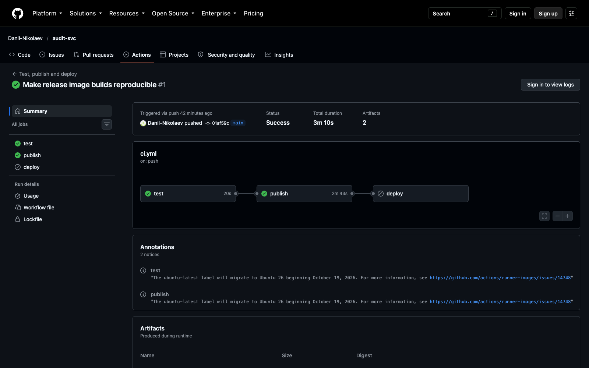

Лог задачи `publish`, загрузка образа в GHCR:

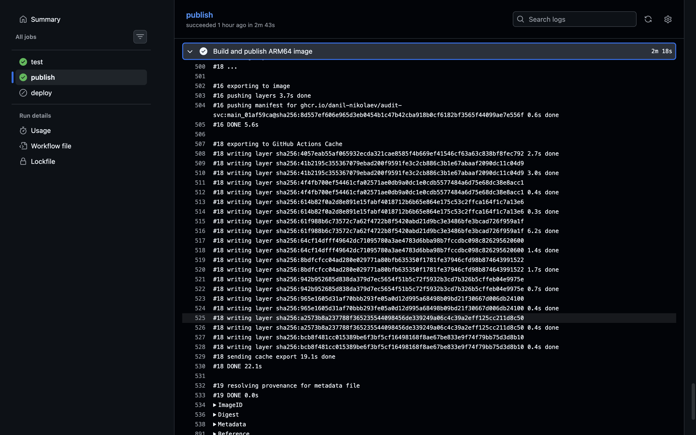

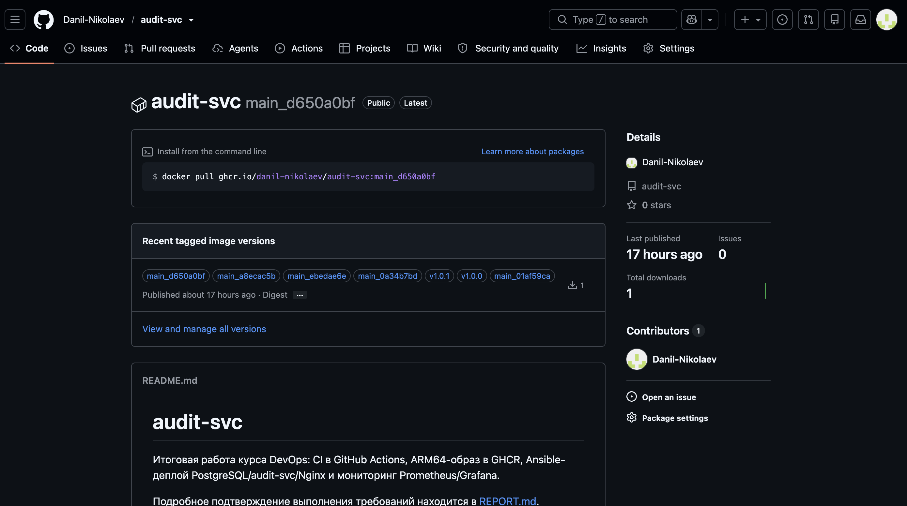

Сборка воспроизводимая: все теги на скриншоте (`main_<sha8>` после каждого push в `main`, релизы `v1.0.0` и `v1.0.1`) собраны из одного кода сервиса и указывают на одну версию образа с одним digest.

### Пайплайн защищённого тега

Теги `v*` защищены ruleset-правилом. Релиз `v1.0.0`: <https://github.com/Danil-Nikolaev/audit-svc/actions/runs/40124204187>. Все три job успешны, `deploy` выполнен на self-hosted runner `devops-vm` (labels `self-hosted, Linux, ARM64, deploy`) в environment `production`.

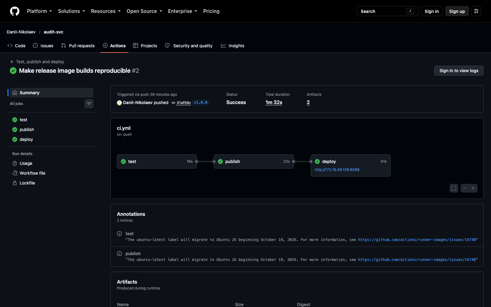

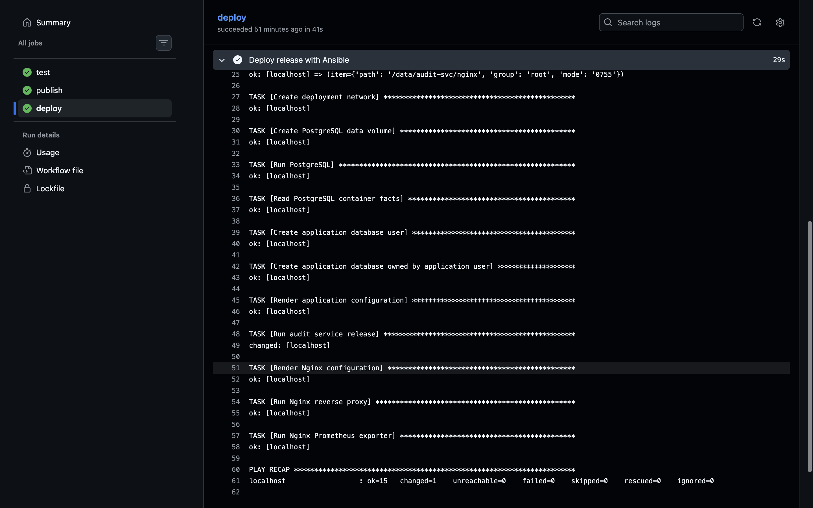

PLAY RECAP первого релиза: `ok=15 changed=1`. Изменилась только задача `Run audit service release`: контейнер переключён на образ, собранный в CI, а БД, пользователь и конфиг уже были созданы проверочным прогоном перед публикацией.

## 2. PostgreSQL и секреты

PostgreSQL 17 работает в контейнере без опубликованного порта. Данные находятся в именованном томе `audit-postgres-data`. Пользователь `audit_svc` и принадлежащая ему БД `audit` создаются модулями `community.postgresql`.

Пароли находятся только в зашифрованном `deploy/inventories/prod/group_vars/all/vault.yml`. Пароль расшифровки хранится в защищённом GitHub Environment secret и передаётся Ansible через `deploy/vault-pass.sh`.

## 3. Развёртывание и перечитывание конфигурации

Релизный job запускается только для тегов `vX.Y.Z` на self-hosted runner с меткой `deploy`. Конфигурация создаётся Ansible-модулем `template` с правами `root:audit-svc 0640`; в контейнер монтируется каталог конфигурации.

При изменении файла handler выполняет внутренний `POST /reload`. Контейнер приложения не перезапускается.

### Идемпотентность

Локальный проверочный запуск перед публикацией:

```text
PLAY RECAP *********************************************************************
localhost : ok=17 changed=14 unreachable=0 failed=0 skipped=0 rescued=0 ignored=0
```

Повторный запуск без изменений:

```text
PLAY RECAP *********************************************************************
localhost : ok=15 changed=0 unreachable=0 failed=0 skipped=0 rescued=0 ignored=0
```

Полный CI-лог первого релизного deploy: <https://github.com/Danil-Nikolaev/audit-svc/actions/runs/40124204187>. Контейнер `audit-svc` пересоздан из образа CI `v1.0.0` и стал healthy. Повторный запуск задачи `deploy` в CI (Re-run jobs релиза `v1.0.1`, attempt 2: <https://github.com/Danil-Nikolaev/audit-svc/actions/runs/40124466801/attempts/2>), образ и конфигурация не менялись. PLAY RECAP: `ok=15 changed=0`, handler не вызывался:

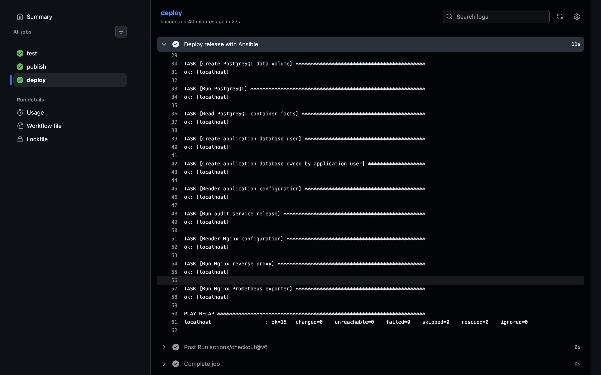

Тот же playbook, запущенный на целевой машине с тем же образом:

```text
PLAY RECAP *********************************************************************
localhost                  : ok=15   changed=0    unreachable=0    failed=0    skipped=0    rescued=0    ignored=0
```

`StartedAt` до и после повторного запуска одинаковый: `2026-10-24T19:13:19.948894225Z`.

### Смена пароля

Новый пароль `audit_svc` сгенерирован (`openssl rand -hex 24`) и записан в зашифрованный `vault.yml`. Коммит `Rotate audit_svc database password`, релиз `v1.0.1`: <https://github.com/Danil-Nikolaev/audit-svc/actions/runs/40124466801>.

Образ `v1.0.1` собран из того же кода и имеет тот же digest. Задачи `Create application database user` и `Render application configuration` получили статус `changed`, после чего сработал handler `Reload audit service configuration` (`POST /reload`). PLAY RECAP: `ok=16 changed=4`. Задача `Run audit service release` тоже `changed`: тег `v1.0.1` впервые скачивается из GHCR (`pull: always`). Но digest тот же, а `image_name_mismatch: ignore` не даёт пересоздать контейнер из-за одного лишь имени тега. Поэтому контейнер не пересоздан, и `StartedAt` не изменился (см. таблицу).

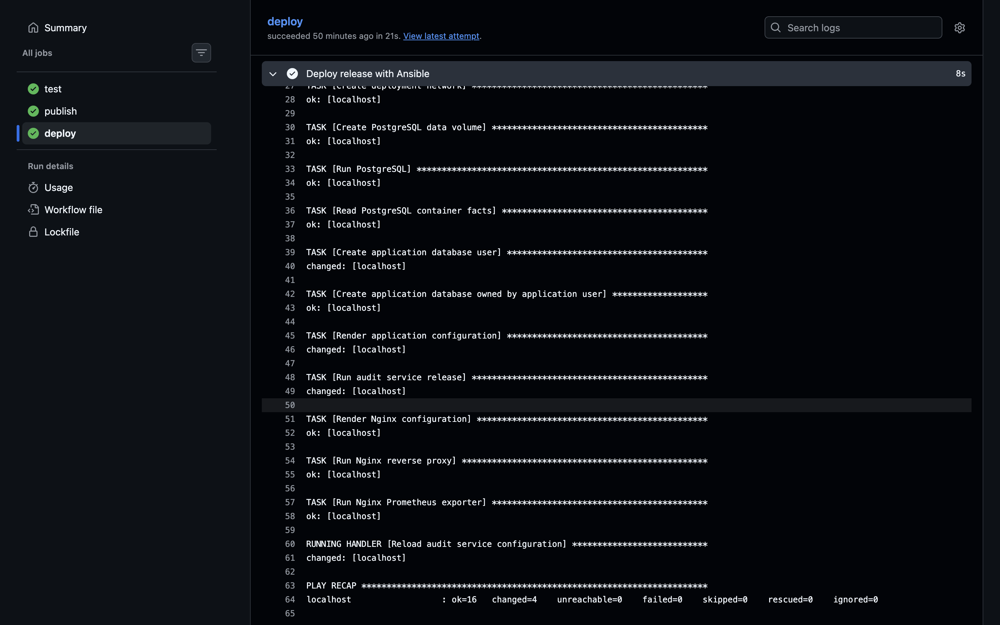

| Проверка | До `v1.0.1` | После `v1.0.1` |
|---|---|---|
| `StartedAt` | `2026-10-24T19:13:19.948894225Z` | `2026-10-24T19:13:19.948894225Z` |
| image | `sha256:8d557ef606e9…` | `sha256:8d557ef606e9…` |
| `audit_config_reloads_total{result="success"}` | 0 | 1 |
| `/healthz` | 200 | 200 |

Лог сервиса:

```text
2026-10-24 19:16:40,081 [INFO] audit_svc.main: config reloaded, reconnected to the database
```

## 4. Nginx и nginx-exporter

Проверки после релизов `v1.0.0`/`v1.0.1`:

```bash
curl -s localhost:8088/healthz
curl -s -o /dev/null -w '%{http_code}\n' -X POST localhost:8088/reload
curl -s -o /dev/null -w '%{http_code}\n' -X POST 'localhost:8088/reload?x=1'
curl -s -o /dev/null -w '%{http_code}\n' -X POST localhost:8088//reload
curl -s -o /dev/null -w '%{http_code}\n' -X POST localhost:8088/%72eload
docker logs audit-svc 2>&1 | grep -c 'config reload'
docker ps --format '{{.Names}}\t{{.Ports}}'
curl -s localhost:9113/metrics | grep '^nginx_up '
```

Фактический результат:

```text
reload_log_count_before=1
healthz=200
reload=404
reload_query=404
double_slash=404
encoded_r=404
reload_log_count_after=1
stub_status_main=404
nginx_up 1

audit-nginx-exporter  0.0.0.0:9113->9113/tcp
audit-nginx           80/tcp, 0.0.0.0:8088->8080/tcp
audit-svc             8080/tcp
audit-postgres        5432/tcp
```

У `audit-svc` и PostgreSQL в колонке `Ports` видны только внутренние exposed-порты, без привязки к адресу хоста.

## 5. Prometheus и Grafana

Prometheus собирает метрики сервиса через Nginx и метрики Nginx через exporter. Собственный dashboard содержит панели событий в секунду по приложениям, процентов HTTP-кодов и состояния `UP`/`DOWN`. Второй dashboard импортирован из официального репозитория nginx-prometheus-exporter.

Проверка API Prometheus:

```text
audit-svc  up
nginx      up
```

Нагрузка 10 минут:

```bash
docker run --rm --name audit-load --network audit-net \
  ghcr.io/danil-nikolaev/audit-svc:v1.0.1 generate --url http://nginx:8080 --rate 20 --duration 600
```

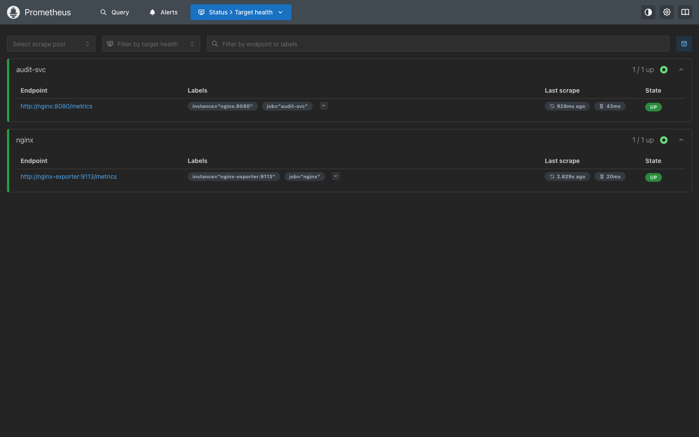

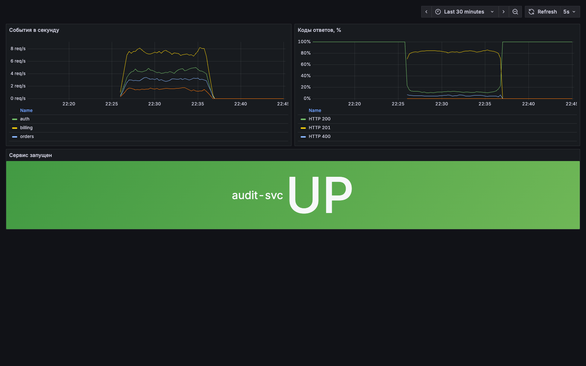

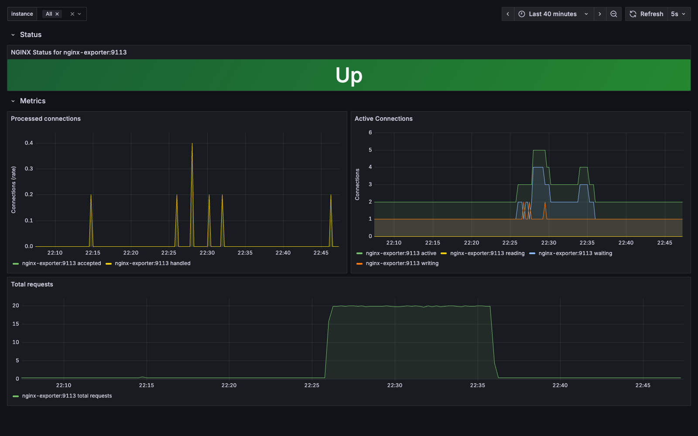

Состояние сервиса: `UP`, затем `DOWN` после `docker stop audit-svc`, после `docker start audit-svc` снова `UP`.

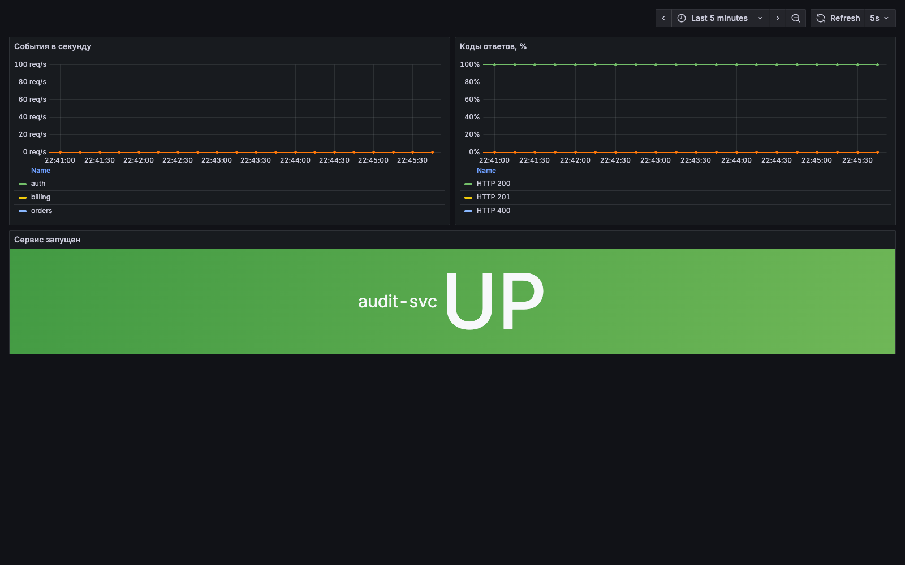

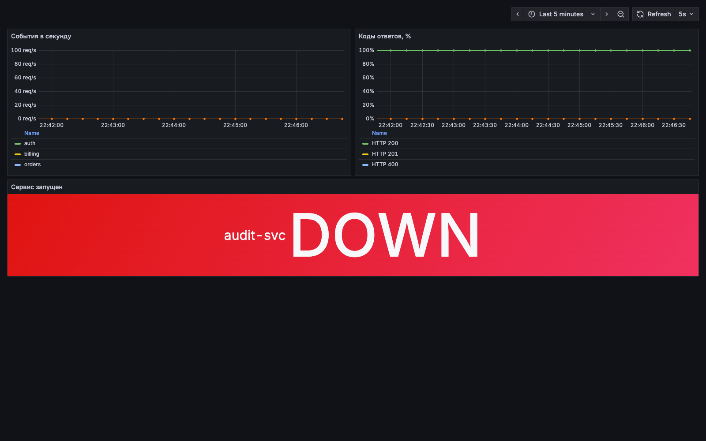
